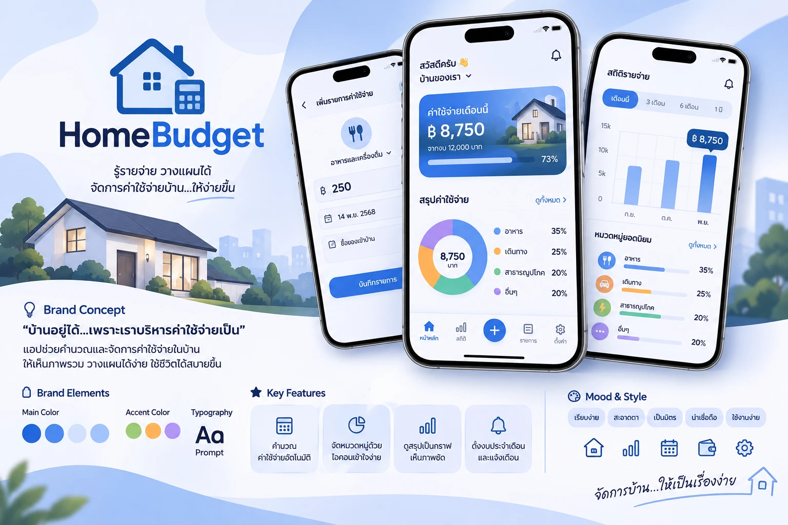

# หลักการออกแบบ — บิลบ้าน

ทุกหน้าจอของแอปนี้ต้องหน้าตาเป็นแบบเดียวกับภาพอ้างอิง [`design/reference.webp`](design/reference.webp)
ถ้าจะเพิ่มหรือแก้หน้าจอไหน ให้อ่านไฟล์นี้ก่อน และใช้ตัวแปร CSS ที่มีอยู่แล้วใน `index.html` เสมอ ห้ามใส่ค่าสีหรือขนาดดิบลงไปใหม่

## อารมณ์ของแอป

**เรียบง่าย · สะอาดตา · เป็นมิตร · น่าเชื่อถือ · ใช้งานง่าย**

- เปิดมาต้องเห็นคำตอบก่อน: เดือนนี้ใช้ไปเท่าไร เหลืองบเท่าไร อะไรยังไม่จ่าย
- พื้นที่ว่างเยอะ การ์ดขาวลอยบนพื้นฟ้าจาง ไม่มีเส้นกรอบแข็งๆ ใช้เงานุ่มแยกชั้นแทน
- น้ำเงินคือสีหลักสีเดียว สีอื่น (เขียว ส้ม ม่วง ฯลฯ) มีไว้แยกหมวดและบอกสถานะเท่านั้น
- ภาษาเป็นกันเอง ("สวัสดี 👋") แต่ตัวเลขต้องชัดและถูกต้องเสมอ

## สี

ตัวแปรทั้งหมดอยู่ที่ `:root` ใน `index.html` และมีชุดธีมมืดคู่กันทุกตัว (ต้องรองรับทั้งสองธีมเสมอ)

| ตัวแปร | สว่าง | มืด | ใช้ทำอะไร |
|---|---|---|---|
| `--ground` | `#F3F6FC` | `#0B1222` | พื้นหลังหน้า (มีก้อนฟ้าจาง `--blob-1/2` ด้านบน) |
| `--surface` | `#FFFFFF` | `#131C30` | การ์ด กล่องโต้ตอบ แถบล่าง |
| `--surface-2` | `#F2F6FD` | `#1A2540` | พื้นช่องกรอก ชิป แถวตอนชี้ |
| `--ink` / `--ink-2` / `--muted` | `#14213D` / `#44527A` / `#64718F` | `#E8EEFA` / `#B7C3DA` / `#8E9BB8` | ตัวอักษร 3 ระดับ |
| `--primary` | `#2463EB` | `#2F66E8` | **พื้น**ปุ่มหลัก ปุ่ม + ช่องที่เลือก แท่งกราฟเดือนนี้ |
| `--accent` | `#2463EB` | `#86A8FF` | **ตัวอักษร/ไอคอน**สีน้ำเงิน ลิงก์ เส้นโฟกัส |
| `--accent-2` | `#4C86F2` | `#5B8CFF` | ปลายไล่สีของปุ่ม + และแท่งกราฟ |
| `--accent-soft` | `#E9F0FE` | `#1C2A4D` | พื้นวงกลมไอคอนสีฟ้า ชิปตอนชี้ |
| `--hero-a` → `--hero-b` | `#2353D8` → `#285CD6` | `#1D43BE` → `#285BCF` | การ์ดสรุปยอดสีน้ำเงิน (ไล่สี 135°) ปลายสว่างต้องยังให้ตัวขาวเล็กผ่าน 4.5:1 |
| `--hero-dim` / `--hero-chip` | ขาว 90% / ขาว 12% | (เหมือนกัน) | ตัวอักษรรองบนการ์ดน้ำเงิน / พื้นป้ายและปุ่มใส — ห้ามเพิ่มความทึบของ chip จะทำให้ตัวขาวบนชิปไม่ผ่าน |
| `--ok` / `--ok-fill` | `#157443` / `#34C17B` | `#4CCB8A` / `#34C17B` | จ่ายแล้ว คืนแล้ว (ตัวอักษร / พื้นจางและแถบ) |
| `--on-ok` | `#FFFFFF` | `#0B1222` | เครื่องหมายถูกบนพื้น `--ok` (วงติ๊กที่ติ๊กแล้ว) |
| `--warn` / `--meter` | `#AD4C0A` / `#F59E0B` | `#F5A94A` | ค้างจ่าย ใกล้ครบกำหนด (ตัวอักษร / พื้น) |
| `--danger` | `#C0271D` | `#FF7B6E` | เลยกำหนด ลบ เกินงบ |
| `--line-strong` | `#7F8CAA` | `#64739A` | ขอบของปุ่มที่ต้องเห็นว่าเป็นปุ่ม (วงติ๊กยังไม่จ่าย) ผ่าน 3:1 ทั้งบน `--surface` และ `--surface-2` |
| `--toast-accent` | `#A9C2FF` | `#1F55D6` | ปุ่ม "เลิกทำ" บนข้อความแจ้ง |

กฎ

- แยก **พื้น** (`--primary`) กับ **ตัวอักษร** (`--accent`) ออกจากกันเสมอ ในธีมมืดสองตัวนี้ไม่เท่ากัน เพื่อให้ตัวอักษรขาวบนปุ่มและตัวอักษรฟ้าบนพื้นมืดผ่านความต่างสี 4.5:1
- ตัวอักษรขนาดปกติต้องผ่าน 4.5:1 ทุกคู่สี **รวมถึงตัวอักษรบนป้ายพื้นจาง** (เช่น `--warn` บนพื้น `--meter` 17%) และตัวอักษรที่ใส่ `opacity` — ถ้าเพิ่มสีใหม่ให้วัดก่อน
- ขอบ/สถานะของปุ่มและกราฟิกที่มีความหมายต้องผ่าน 3:1 (วงติ๊ก ปุ่มเลือก)
- ทำให้จางด้วย `opacity` ได้ไม่ต่ำกว่า .65 สำหรับตัวอักษร (รายการที่จ่ายแล้ว) และห้ามใช้ opacity กับตัวเลขรองในชิป
- **ข้อยกเว้นที่ตั้งใจ:** ช่องกรอกเป็นพื้น `--surface-2` ไม่มีเส้นขอบ (ต่างจากพื้นการ์ดไม่ถึง 3:1) — ผู้ใช้เลือกคงไว้ 2026-11-24 เพราะทุกช่องมีป้ายชื่อด้านบนและข้อความตัวอย่างในช่อง ตอนโฟกัสมีกรอบ `--accent` ชัด
- แถบงบ/แถบความคืบหน้าบนการ์ดน้ำเงินไม่ถึง 3:1 กับราง แต่มีตัวเลข % กำกับข้างแถบเสมอ — ห้ามเอาตัวเลขออก
- ห้ามใช้สีเป็นสิ่งเดียวที่บอกความหมาย ต้องมีคำหรือไอคอนกำกับด้วย (เช่น ป้าย "เลยกำหนด")

### สีหมวด

กำหนดใน `CATS` ในสคริปต์ ใช้ได้ทั้งสองธีม

| หมวด | สี | | หมวด | สี |
|---|---|---|---|---|
| ค่าไฟฟ้า | `#F59E0B` | | ค่าแก๊ส | `#EF4444` |
| ค่าน้ำประปา | `#0EA5E9` | | ค่าสมาชิก / สตรีมมิ่ง | `#A855F7` |
| ค่าอินเทอร์เน็ต | `#6366F1` | | ค่ารถ / น้ำมัน | `#F97316` |
| ค่ามือถือ | `#EC4899` | | ค่าประกัน | `#14B8A6` |
| ค่าเช่า / ผ่อนบ้าน | `#2563EB` | | ของใช้ในบ้าน | `#22C55E` |
| อื่นๆ | `#94A3B8` | | | |

ไอคอนหมวดมีสองแบบ:
- **ในแถวรายการ** — วงกลมพื้นจาง (สีหมวด 15%) ไอคอนเป็นสีหมวด
- **ในสรุปตามหมวด** — วงกลมพื้นทึบสีหมวด ไอคอนสีขาว + แถบสัดส่วนสีเดียวกัน

## ตัวอักษร

- ฟอนต์ **Prompt** (น้ำหนัก 400 / 500 / 600 / 700) โหลดจาก Google Fonts
  ถ้าออฟไลน์จะตกไปใช้ Leelawadee UI / Noto Sans Thai / Sukhumvit Set ของเครื่องเอง **แอปต้องใช้งานได้ครบโดยไม่มีฟอนต์นี้**
- ตัวเลขทุกที่ใช้ `font-variant-numeric: tabular-nums` หลักจะได้ตรงกัน ไม่ใช้ฟอนต์ monospace อีกแล้ว (เหลือแค่ป้ายคีย์ลัด)
- ไม่ใช้ตัวพิมพ์ใหญ่ทั้งคำหรือระยะห่างตัวอักษรกว้างแบบป้ายภาษาอังกฤษ

| ใช้กับ | ขนาด | น้ำหนัก |
|---|---|---|
| ยอดใหญ่บนการ์ดน้ำเงิน | 38–60px (มือถือ 34–46px) ทศนิยม 0.42em | 600 |
| ชื่อเดือนบนหัวจอมือถือ | 24px | 600 |
| หัวการ์ด | 17px | 600 |
| หัวกล่องโต้ตอบ / แผ่นล่าง | 18px | 600 |
| หัวหน้าตั้งค่า (จอใหญ่) | 26px | 600 |
| หัวหมวดในหน้าตั้งค่า | 13px สี `--muted` | 600 |
| ตัวหนังสือปกติ ชื่อรายการ | 15px | 400–500 |
| ป้ายช่องกรอก คำอธิบาย | 13–13.5px | 500 / 400 |
| ป้ายเล็ก (วันครบกำหนด ชื่อเดือนใต้กราฟ) | 12px | 500 |

## รูปทรงและเงา

| ตัวแปร | ค่า | ใช้กับ |
|---|---|---|
| `--r-s` | 14px | ช่องกรอก ปุ่ม |
| `--r` | 20px | การ์ด ตัวเลขย่อย |
| `--r-l` | 24px | การ์ดน้ำเงิน กล่องโต้ตอบ (มือถือขอบบน 28px) |
| `--pill` | 999px | ชิป ปุ่มสลับ แท็บ แถบความคืบหน้า ป้ายเล็ก |
| วงกลม | 50% | ไอคอนหมวด ปุ่มติ๊ก ปุ่มไอคอน ปุ่ม + |

- การ์ดไม่มีเส้นกรอบ ใช้ `--shadow-m` (เงาโทนน้ำเงิน นุ่ม ฟุ้งลงล่าง)
- การ์ดน้ำเงินใช้ `--shadow-hero` ปุ่มหลักมีเงาสีของตัวเองจางๆ
- ช่องกรอกเป็นพื้น `--surface-2` ไม่มีกรอบ ตอนโฟกัสขึ้นกรอบ `--accent` + วงฟุ้ง `--accent-soft` 4px

## องค์ประกอบหลัก

**หัวจอ**
- มือถือ: "สวัสดี 👋" ตัวเล็กด้านบน ชื่อเดือนตัวใหญ่ + ลูกศรลง (แตะเปิดตัวเลือกเดือน) ปุ่มวงกลม ‹ › อยู่ขวา ปุ่มธีม (☾/☀) เป็นไอคอนเปล่าบนแถว "สวัสดี" ไม่มีวงกลมขาว (ไม่ให้ซ้อนเป็นกองกับ ‹ ›) สองแถวห่างกัน 8px หัวจอเลื่อนหายไปกับหน้า
- จอใหญ่: โลโก้บ้าน + เครื่องคิดเลข "บิล**บ้าน**" (คำหลังสีฟ้าอ่อน) · แท็บแบบเม็ดยา · ตัวเลือกเดือนตรงกลาง · ปุ่มวงกลมด้านขวา ติดด้านบนพร้อมพื้นเบลอ

**การ์ดสรุปยอดสีน้ำเงิน (hero)** — หนึ่งใบต่อหน้า
- หัวข้อ ("ค่าใช้จ่ายเดือนนี้") → ยอดใหญ่ ฿ → "จากงบ … บาท · เหลือ … บาท" → แถบความคืบหน้าสีขาวบนรางโปร่ง + เปอร์เซ็นต์ด้านขวา
- รูปบ้าน 3 มิติบนเกาะหญ้าอยู่มุมขวาบน เป็นของตกแต่ง (`aria-hidden`) ห้ามมีข้อความทับรูป
  - ไฟล์ [`design/house.webp`](design/house.webp) (พื้นใส กว้าง 400px ราว 21 KB) ฝังไว้ใน CSS ครั้งเดียวเป็นตัวแปร `--house-img` ทั้งสองหน้าใช้ร่วมกัน แอปจึงยังเป็นไฟล์เดียวและออฟไลน์ได้
  - ต้นฉบับฉากอยู่ที่ [`design/house-3d.html`](design/house-3d.html) (three.js) จะแก้รูปให้แก้ที่นั่น เรนเดอร์ใหม่ แล้วแทนค่า base64 เดิม ห้ามเอาภาพจากเว็บมาใส่แทน
  - **ตัวเลขสำคัญกว่ารูป:** `fitHeroArt()` วัดทุกครั้งที่วาดหน้าและเมื่อปรับขนาดจอ ถ้ายอดยาวจนชนรูป รูปจะย่อเหลือ 68px (`.art-s`) ถ้ายังชนก็ซ่อน (`.art-off`) — เกิดเฉพาะจอแคบมากกับยอดหลักแสนขึ้นไป
- แถบเกิน 80% เป็นสีเหลืองอุ่น เกิน 100% เป็นสีส้มแดง

**ตัวเลขย่อย** — การ์ดขาวเล็กข้างการ์ดน้ำเงิน: ไอคอนในวงกลมสีจาง + ป้าย + ตัวเลข (จ่ายแล้วสีเขียว ค้างจ่ายสีส้ม) มือถือเรียงสองช่อง

**แถวรายการ** — ไอคอนวงกลม 44px · ชื่อ (บรรทัดบน) + ป้ายวันครบกำหนด (บรรทัดล่าง) · ยอดชิดขวา · ปุ่มติ๊กวงกลม
- วงติ๊กยังไม่จ่าย = ขอบ `--line-strong` 2px · ติ๊กแล้ว = พื้น `--ok` เครื่องหมาย `--on-ok`
- ชื่อปุ่มสำหรับโปรแกรมอ่านหน้าจอต้องบอกรายการ: "จ่ายแล้ว: ค่าไฟฟ้า" (ใช้ `aria-pressed` บอกสถานะ ห้ามสลับชื่อปุ่มไปมา) · "แก้ไข ค่าไฟฟ้า 1,240.50 บาท"
- **มือถือ:** ปุ่มดินสอไม่ถูกซ่อน แต่ขยายเต็มแถวแบบโปร่งใส (`position:absolute; inset:0` ซ่อนไอคอน) แตะที่แถว = กดปุ่มนี้ โปรแกรมอ่านหน้าจอและคีย์บอร์ดจึงเปิดแก้ไขได้ วงติ๊กอยู่ชั้นบน (`z-index:1`) · แถวคืนเงินบนมือถือซ่อนเฉพาะปุ่มลบ (ลบในกล่องแก้ไข)
- หลังติ๊ก/แก้ไข รายการถูกวาดใหม่ โฟกัสต้องกลับไปที่ปุ่มเดิมของแถวเดิม (`refocus`) ถ้าแถวถูกลบให้ไปที่หัวการ์ดรายการ
- ไม่มีเส้นคั่นและไม่มีแถวสลับสี ใช้ช่องไฟแยก ชี้/แตะแล้วพื้นเป็น `--surface-2` มุมมน 16px
- **มีปุ่มเดียวในแถวคือติ๊กจ่ายแล้ว** แตะที่ตัวแถว = แก้ไข ลบกับตั้งบิลประจำอยู่ในกล่องแก้ไข (จอใหญ่มีดินสอเพิ่มได้ มือถือห้าม)

**ปุ่ม**
- หลัก: พื้น `--primary` ตัวขาว สูง 44px (มือถือในแผ่นล่าง 50px เต็มความกว้าง)
- รอง (`ghost`): พื้น `--surface-2` ตัวอักษร `--accent`
- อันตราย: กรอบแดงจาง ตัวแดง ชี้แล้วพื้นแดง
- บนการ์ดน้ำเงิน (`.hbtn`): ปุ่มหลักพื้นขาว ตัวอักษร `--hero-a` · ปุ่มรอง (`.hbtn.ghost`) พื้น `--hero-chip` ตัวขาว · เส้นโฟกัสบนการ์ดน้ำเงินเป็นสีขาว · มือถือสองปุ่มเต็มแถว ปุ่มหลักกว้างกว่า
- หนึ่งหน้าจอมีปุ่มหลักได้ปุ่มเดียว (ปุ่มขาวบนการ์ดน้ำเงินนับเป็นปุ่มหลักของหน้านั้น)

**ชิป / ปุ่มสลับ / แท็บ** — ทรงเม็ดยา ตัวที่เลือกเป็นพื้น `--primary` ตัวขาว (ปุ่มสลับสองตัวเลือกใช้พื้นขาวยกนูนบนราง)

**แถบเมนูล่าง (มือถือเท่านั้น)** — หน้าหลัก · สถิติ · **ปุ่ม + วงกลมน้ำเงินยกลอย** · คืนเงิน · ตั้งค่า
- ตัวที่อยู่ตอนนี้เป็นสี `--accent` ตัวหนา ที่เหลือ `--muted`
- ปุ่ม + ทำ "สิ่งที่ควรทำต่อ" ของหน้านั้น: หน้าบิล (และหน้าตั้งค่า ซึ่งพากลับไปหน้าบิล) เปิดแผ่นเพิ่มรายการ · หน้าคืนเงินเปิดกล่องบันทึกการคืน (ยังไม่มีสมุด = กล่องตั้งยอดค้าง, ปลดหนี้แล้ว = ยืมเพิ่ม) และป้ายเสียงอ่านของปุ่มเปลี่ยนตาม · คีย์ลัด N ทำเหมือนปุ่ม +
- จอใหญ่ไม่มีแถบนี้ ใช้แท็บด้านบนกับฟอร์มในการ์ดแทน

**แผ่นเลื่อนขึ้นจากล่าง (มือถือ)** — ฟอร์มเพิ่มรายการและกล่องโต้ตอบทุกอันหน้าตาเดียวกัน ไม่ว่าเปิดจากหน้าไหน
- ขึ้นจากขอบล่าง มุมบนโค้ง 28px มีขีดจับ 40×5px ด้านบน (`dialog::before`) พื้นหลังมืดลง
- หัวข้อ 18px · ปุ่มล่างสูง 50px แบ่งความกว้างกัน (ปุ่มหลักขวาสุด)
- แตะพื้นหลังหรือกด Esc = ปิดโดยไม่บันทึก (ทุกกล่อง นับเฉพาะเมื่อกดลง **และ** ปล่อยนอกตัวกล่อง ลากเลือกข้อความออกนอกกล่องจะไม่ปิด)

**กล่องกรอกตัวเลข** (ใช้ในหน้าคืนเงิน ใช้ซ้ำได้ทุกที่)
- ช่องเงินหลักของกล่องใช้ `.inp.amt.big` (สูง 56px ตัว 24px)
- ปุ่มลัดยอดเป็นชิปสูง 40px ใต้ช่องเงิน (`.qchips`) เช่น "ตามงวด 3,000" "ปิดยอด 42,000" — มือถือไม่โฟกัสช่องเงินเอง แป้นพิมพ์จะได้ไม่บังชิป แตะครั้งเดียวจบ
- บอกผลล่วงหน้าในกล่อง `.ln-after` ก่อนกดบันทึก ("บันทึกแล้ว ค้างคืนเหลือ …") เขียว = ครบพอดี เหลือง = เกินยอด
- ข้อความผิดอยู่ใต้ช่องนั้น (`.ferr` สีแดง + `aria-invalid`) ไม่ปิดกล่อง ไม่ใช้ toast · คำอธิบายช่องใช้ `.fhelp`
- Enter ในช่องกรอก = กดปุ่มบันทึก (`enterSubmits`) เพราะถ้าปล่อยเบราว์เซอร์ มันจะกดปุ่มปิดที่อยู่บนสุดของฟอร์ม
- อ่านผลกล่องด้วย `onDialogResult` เท่านั้น (ใช้ธงกันนับซ้ำ ไม่ใช้จับเวลา — เครื่องช้า close มาช้าแล้วบันทึกซ้ำ) ตัวตรวจค่าต้องผูก `submit` ก่อน `onDialogResult` แล้ว `stopImmediatePropagation` เมื่อค่าไม่ผ่าน

**หน้าคืนเงิน** — ยืมจากบัญชีตัวเองแล้วทยอยคืน เป็นก้อนเดียว ไม่นับรวมยอดบิล
- ยังไม่มีสมุด: การ์ดน้ำเงินใบเดียวเต็มแถว หัวข้อ "เริ่มจากยอดที่ค้างอยู่ตอนนี้" + ปุ่มขาว "ตั้งยอดค้างคืน" ปุ่มเดียว ไม่มีกราฟเปล่าหรือรายการว่าง
- ตั้งยอดได้ทันทีโดยไม่ต้องย้อนหารายการเก่า (บันทึกเป็นรายการ "ยอดยกมา" อยู่บนสุดของสมุดเสมอ) พร้อมงวด "คืนเดือนละ … ทุกวันที่ …" และแสดง "หมดราว … · อีก n งวด" ระหว่างพิมพ์
- แก้ยอดค้างภายหลังในกล่องแผน = เพิ่มรายการ "ปรับยอด" ประวัติเดิมไม่หาย และไม่นับเป็นการคืน
- การ์ดน้ำเงิน: "ค้างคืนอีก" + ชื่อบัญชี (แตะ = แก้แผน) → ยอดใหญ่ → "คืนแล้ว X จาก Y บาท" + แถบ → "หมดราว …" → ปุ่มขาว "บันทึกการคืน" + ปุ่มใส "ยืมเพิ่ม" · ปลดหนี้แล้วเหลือแต่ "ยืมเพิ่ม"
- การ์ดงวดเดือนนี้ (`.inst`) อยู่บนสุดของคอลัมน์ข้าง: ยอดที่ต้องคืนอีก + ป้ายวัน ("อีก 6 วัน" / "ครบวันนี้" สีส้ม ≤3 วัน / "เลยกำหนด 4 วัน" สีแดง) + แถบส่วนที่คืนแล้ว (น้ำเงินเสมอ ครบงวดเป็นเขียว — สีเตือนอยู่ที่ป้ายกับตัวเลข ไม่ใช่ที่เงินที่คืนไปแล้ว) · ยังไม่ตั้งงวดมีปุ่มรอง "ตั้งงวดคืน" · ปลดหนี้แล้วซ่อนการ์ดนี้
- งวดแรก: ตั้งแผนหลังวันครบกำหนดของเดือนนี้และเดือนนี้ยังไม่ได้คืน = เริ่มเดือนหน้า (ไม่ขึ้น "เลยกำหนด" ทันทีที่ตั้งเสร็จ)
- สมุดรายการแบ่งหัวเดือน (ชื่อเดือน + "คืน X" สีเขียว) แถวสองบรรทัดทุกจอ: ชื่อ/บันทึกช่วยจำ + ยอด / ประเภท·วันที่ + "ค้าง X" · **ไม่มีเครื่องหมาย +/−** บอกด้วยคำและไอคอน: คืนเงิน ✓ เขียว · ยืมเพิ่ม ↗ แดง · ยอดยกมา ธง น้ำเงิน · ปรับยอด ลูกศรวน เทา
- กราฟยอดคืนรายเดือน: แท่งที่คืนถึงงวดเป็นสีเขียว มีคำอธิบายใต้กราฟ ("สีเขียว = คืนครบงวดของเดือนนั้น") ยังไม่เคยคืนแสดงข้อความแทนกราฟเปล่า
- ตัวเลขเงินที่มีสตางค์แสดงทศนิยม (`fmtA`) ไม่ปัดขึ้นให้ดูเหมือนคืนมากกว่าจริง

**หน้าตั้งค่า** — หน้าจริง ไม่ใช่กล่องเมนู (`state.page = "settings"` ไม่จำข้ามการเปิดแอป เปิดใหม่กลับไปหน้าที่ใช้งานจริง)
- เข้าจาก: จอใหญ่ = ปุ่มฟันเฟืองมุมขวา (อยู่หน้านี้แล้วปุ่มเป็นพื้น `--primary` กดซ้ำ = กลับหน้าที่มา) · มือถือ = "ตั้งค่า" ในแถบล่าง
- ความกว้างไม่เกิน 760px แบ่งหมวด: หัวหมวดเล็กสีจางอยู่นอกการ์ด → การ์ดขาวรวมแถวของหมวดนั้น
- ลำดับหมวด: ค่าใช้จ่ายรายเดือน · หน้าตา · ข้อมูลและการสำรอง · คีย์ลัด · ล้างข้อมูล (อันตรายอยู่ท้ายสุด แยกการ์ดเอง)
- แถว = ไอคอนวงกลม + ชื่อ + คำอธิบายบรรทัดล่างที่บอก **ผลจริงตอนนี้** (เช่น "ยก 2 รายการจาก ต.ค. 2569 มาไว้ที่ พ.ย. 2569", จำนวนรายการที่จะสำรอง) + ค่าปัจจุบัน/ลูกศรด้านขวา · ทำไม่ได้ตอนนี้ = ปุ่มจาง (`disabled`) พร้อมบอกเหตุผล ไม่ซ่อน
- แถว "ข้อมูลอยู่ที่ไหน" บอกตรงๆ ว่าซิงค์อยู่ / อยู่ในเบราว์เซอร์นี้เท่านั้น / บันทึกถาวรไม่ได้ (เขียว / น้ำเงิน / ส้ม)
- ธีม: ปุ่มสลับสามช่อง ตามเครื่อง · สว่าง · มืด (ตามเครื่องเปลี่ยนตามมือถือทันที) ธีมไม่ซิงค์ แต่ละเครื่องเลือกเอง
- คีย์ลัดแสดงเฉพาะจอที่มีเมาส์และกว้างกว่า 760px (`hover:hover and pointer:fine`) มือถือ/แท็บเล็ตไม่เห็น
- ส่งออก CSV แยกปุ่ม บิล / สมุดคืนเงิน (ไม่มีสมุดก็ไม่แสดงปุ่มหลัง) · พิมพ์ได้เฉพาะใบสรุปบิล กดจากหน้าตั้งค่าจะพากลับหน้าบิลก่อนพิมพ์

**สถานะว่าง** — ห้ามแสดงกราฟเปล่า (วงเทาเปล่าดูเหมือนแอปค้าง) ให้มี: ไอคอนในวงกลม · ประโยคบอกว่าทำไมว่าง (ตัวหนา) · ประโยคบอกว่าทำแล้วจะได้อะไร · ปุ่มรองไม่เกินสองปุ่มที่พาไปทำต่อ
- โดนัทเดือนที่ไม่มีรายการ: "เดือนนี้ยังไม่มีรายการ" + "เพิ่มรายการ" / "ดึงบิลประจำ" (มีบิลประจำจึงแสดง)
- มีรายการแต่ยังเป็น 0 บาททั้งหมด: "เดือนนี้ยังไม่ได้ใส่ยอดเงิน" + "ไปใส่ยอดเงิน" (ไม่ชวนเพิ่มรายการซ้ำ)
- กราฟแท่ง 6 เดือนที่ว่างทั้งหมด: ซ่อนการ์ดไปเลย

**กราฟ**
- โดนัท: วงหนา มีช่องว่างเล็กระหว่างสี ตรงกลางเป็นยอดรวม + "บาท" รายการหมวดอยู่ใต้โดนัทเต็มความกว้าง
- แท่ง: แท่งมนกว้างไม่เกิน 30px เดือนอื่นสีฟ้าจาง เดือนที่เลือกไล่สีน้ำเงิน มีฟองป้ายยอด "฿8,750" หางชี้ลง

**ข้อความแจ้ง (toast)** — เม็ดยาสีกรมท่า (ธีมมืดเป็นสีอ่อน) ลอยเหนือแถบล่าง มีปุ่ม "เลิกทำ" ทุกครั้งที่ลบหรือเพิ่ม
- โปรแกรมอ่านหน้าจออ่านผ่านพื้นที่ประกาศ `#toastLive` (`role="status"` มีอยู่ในหน้าตลอด ล้างก่อนแล้วค่อยใส่ข้อความ)
- หยุดนับเวลาตอนชี้เมาส์หรือโฟกัสอยู่ · Ctrl/⌘+Z = กด "เลิกทำ" ของข้อความล่าสุดที่ยังอยู่ (นอกช่องกรอก)

## ไอคอน

- วาดเองเป็น inline SVG ทั้งหมด อยู่ในแผ่น `<symbol>` บนสุดของ `<body>` ห้ามโหลดจาก CDN
- เส้น 2px หัวมน มุมมน กรอบ 24×24 `stroke: currentColor` ไม่มีพื้นทึบ
- ไอคอนเกือบทุกตัวอยู่ในวงกลม (ดูสีหมวดด้านบน) ไอคอนลอยเปล่าใช้เฉพาะในปุ่มและแถบเมนู

## การเคลื่อนไหว

ระดับ "มากขึ้นนิดหนึ่ง" แบบมืออาชีพ: สิ่งที่กดทั้งวันต้องเร็ว ลูกเล่นเก็บไว้ให้จังหวะที่เกิดไม่บ่อย (เปิดหน้า จ่ายครบ สลับธีม)
ทุกค่าอยู่ในตัวแปรบน `:root` ห้ามใส่ค่าเวลาหรือเส้นโค้งดิบใหม่ · ไม่ใช้ไลบรารี ทำด้วย CSS + Web Animations API ล้วน

**สปริง** (ค่าเป็น "เวลา + เส้นโค้ง `linear()`" ใช้ทั้งก้อน เช่น `transition: scale var(--spring-press)`)

| ตัวแปร | เวลา | ใช้กับ |
|---|---|---|
| `--spring-press` | 473ms | ปุ่มยุบตอนกด (0.97 · แถว/การ์ด 0.985) |
| `--spring-selection` | 350ms | ของที่เลื่อนไปหาตัวที่เลือก: แถบแท็บ ปุ่มสลับสองฝั่ง พื้นแถบล่าง |
| `--spring-reflow` | 298ms | แถวรายการเลื่อนไปที่ใหม่หลังเรียงใหม่ (FLIP) |
| `--spring-entrance` | 591ms | การ์ดและแถวลอยขึ้นตอนเปิดหน้า |
| `--spring-dialog` | 729ms | กล่องโต้ตอบบนจอใหญ่ (เอียงจาก `rotateX(-20deg)` + ย่อ 0.8 + เบลอ 4px) |
| `--spring-toast` | 507ms | ข้อความแจ้งลอยขึ้นจากล่าง |
| `--spring-check` | 486ms | ไอคอน "จ่ายครบแล้ว" เด้งเข้ามา |
| `--spring-tell` | 945ms | ตัวเลขที่กำลังบอก: ยอดหมุน แถบงบ โดนัท แท่งกราฟ (ไม่เด้งเกิน อ่านได้เร็ว) |

**ทวีน** (เลือกเส้นโค้งตามหน้าที่: เข้า/ออก = ease-out, ของที่ถูกปิดทิ้ง = `--ease-away`, เส้นที่วาดตัวเอง = `--ease-draw`)

| ตัวแปร | ใช้กับ |
|---|---|
| `--t-color` .2s | เปลี่ยนสีพื้น สีตัวอักษร เส้นขอบ |
| `--t-swap` .15s | ไอคอนสลับกัน |
| `--t-menu` .22s | ตัวเลือกหมวด ปฏิทิน ตัวเลือกเดือน งอกจากปุ่มที่กด (0.9 → 1) |
| `--t-reveal` .3s | ของจางเข้าชัดขึ้น (ชื่อเดือนใหม่ การ์ดเปิดหน้า) |
| `--t-fill` / `--t-check` | วงติ๊กเต็มสี / เครื่องหมายถูกและเส้นขีดฆ่าวาดตัวเองตามหลัง |
| `--t-sheet` / `--t-overlay` .4s | แผ่นล่างบนมือถือ / ฉากมืดหลังกล่อง |
| `--t-dismiss` .2s | ทุกอย่างที่ปิดหายไป (เร็วกว่าตอนเปิดเสมอ) |
| `--t-flash` 1.4s | แถวที่เพิ่งเพิ่มหรือเลิกลบ ไฮไลต์จางลง |
| `--t-theme` .5s | สลับธีม: วงกลมกระจายจากปุ่มธีม (View Transitions) |
| `--t-count` .7s | ตัวเลขย่อยนับขึ้นลง |

**จังหวะ**
- เปิดหน้า: การ์ดลอยขึ้นทีละใบห่าง 50ms แล้วแถวรายการไหลตามห่าง 30ms (เฉพาะเปิดหน้าและเปลี่ยนเดือน)
- ติ๊กจ่ายแล้ว: วงเต็มสีจากกลาง → ถูกวาดตัวเอง → ขีดฆ่าวิ่งซ้ายไปขวา → 520ms ต่อมาแถวเลื่อนไปที่ใหม่ วงติ๊กไม่ยุบตอนกด (เป็นช่องติ๊ก)
- แถวที่เลื่อนไกลกว่า 1.2 แถวยกตัวขึ้นมีเงา (`.lift`) จะได้ไม่ทับกันกลางทาง แถวที่ลบจางและย่อหายในที่เดิม
- แท่งกราฟขยับด้วย `height` ไม่ใช่ `transform` (ยกเว้นตั้งใจ) เพราะป้ายตัวเลขต้องลอยตามยอดแท่ง
- ปุ่มสลับ `.seg` มีพื้นเลื่อนชิ้นเดียว ใส่ `--n` เท่าจำนวนตัวเลือก (`.seg.three` ตั้งไว้แล้ว)
- การชี้เมาส์ใส่ใน `@media (hover:hover) and (pointer:fine)` เสมอ มือถือจะได้ไม่มีสีค้าง

**ลดการเคลื่อนไหว** (`prefers-reduced-motion`): `--m` เป็น 0 ทุกระยะทาง การย่อ และการหมุนหายไป เหลือแค่จางเข้าออก ตัวเลขเปลี่ยนทันที ห้ามลบ
Safari ที่ยังไม่รองรับ `overlay` จะปิดกล่องโต้ตอบทันทีโดยไม่มีท่าออก (ตั้งใจ)

## ขนาดจอ

| ช่วง | โครง |
|---|---|
| > 960px | สองคอลัมน์ (เนื้อหา 1.6 : ข้าง 1) การ์ดน้ำเงินคู่กับตัวเลขย่อยสามช่อง (หน้าคืนเงิน: การ์ดงวด + ตัวเลขย่อยสองช่องเรียงลง) |
| 761–960px | คอลัมน์เดียว ตัวเลขย่อยเรียงสามช่องในแถวเดียว (หน้าคืนเงิน: การ์ดงวดเต็มแถว + ตัวเลขย่อยคู่กัน) |
| ≤ 760px | หัวจอแบบทักทาย (หน้าคืนเงิน/ตั้งค่าแสดงชื่อหน้าแทนชื่อเดือน) แถบเมนูล่าง ฟอร์มกลายเป็นแผ่นล่าง แยกมุมมอง "หน้าหลัก" กับ "สถิติ" |

- ขอบซ้ายขวามือถือ 16px ห้ามมีการเลื่อนแนวนอน (ทดสอบที่ 320px)
- ≤ 360px: ช่องครึ่งจอที่ตัวเลขอาจถูกตัด ให้ซ่อนไอคอนวงกลมหรือเรียงลงแทน (เช่น วันที่กับบันทึกช่วยจำในกล่องบันทึกการคืน)
- เป้าแตะอย่างน้อย 40px
- ≤ 360px: ซ่อนไอคอนวงกลมของตัวเลขย่อย (`.kvs .kv-ic`) ทุกหน้า ยอดหลักหมื่นจะได้ไม่ถูกตัดเป็น "13,678…"
- หัวจอติดบน (จอใหญ่) และแถบล่าง (มือถือ) ต้องมี `scroll-padding` ที่ `html` กันช่องที่โฟกัสโดนบัง

## คำที่ใช้ในแอป

ใช้คำเดียวกันทุกที่ ห้ามสลับคำที่ความหมายเดียวกัน

| คำ | ความหมาย | ห้ามใช้ |
|---|---|---|
| **จ่าย** / จ่ายแล้ว / ค้างจ่าย | บิลที่ต้องจ่ายในเดือนนั้น (หน้าบิล) | ชำระ (ยกเว้นในชื่อบิลที่ผู้ใช้พิมพ์เอง) |
| **บิลประจำ** | บิลที่มาทุกเดือน ดึงเข้าเดือนใหม่ได้ | รายการซ้ำ เทมเพลต |
| **ยืม** / ยืมเพิ่ม | เอาเงินออกจากบัญชีตัวเอง (หน้าคืนเงิน) | เบิก ถอน เอาออก |
| **คืน** / คืนเงิน / คืนแล้ว | โอนกลับเข้าบัญชีนั้น | ชำระหนี้ ผ่อน |
| **ค้างคืน** / ค้าง X | ยอดที่ยังไม่ได้คืน = ยืมทั้งหมด (รวมยอดยกมา) − คืนแล้ว | หนี้คงเหลือ ยอดหนี้ |
| **งวด** / งวดเดือนนี้ / อีก n งวด | ยอดที่ตั้งใจคืนต่อเดือน | ผ่อน ค่างวด |
| **ยอดยกมา** · **ปรับยอด** | ยอดค้างตอนเริ่มสมุด · แก้ยอดค้างภายหลัง (ไม่นับเป็นการคืน) | — |
| **ปลดหนี้แล้ว** | ค้างคืนเหลือ 0 | หมดหนี้ ชำระครบ |
| **สำรองข้อมูล** · **กู้คืน** | ส่งออก/นำกลับไฟล์ .json | backup, restore, นำเข้า |
| **ตั้งค่า** | หน้าตั้งค่า (ป้ายแถบล่าง ปุ่มฟันเฟือง หัวหน้า) | เมนู |

- ปุ่มบอกสิ่งที่จะเกิดเป็นคำกริยา ("บันทึกการคืน" "ตั้งยอดค้างคืน") ไม่ใช่ "ตกลง" ถ้าบอกได้
- ข้อความที่อ้างตำแหน่งบนจอ ("การ์ดด้านขวา") ใช้ไม่ได้ เพราะมือถือเรียงคนละแบบ ให้อ้างชื่อการ์ดหรือชื่อหน้าแทน ("ตั้งค่า → สำรองข้อมูล")
- ไม่มีชื่อเดือนเต็มในที่แคบ ใช้แบบย่อ "พ.ย. 2569"

## การเข้าถึง (โปรแกรมอ่านหน้าจอ / คีย์บอร์ด)

- **h1 เดียวต่อหน้า** คือ `#pTitle` ("บิลรายเดือน" / "สมุดคืนเงิน" / "ตั้งค่า") จอใหญ่ซ่อนแบบอ่านได้ (เห็นแท็บที่เลือกแทน) มือถือแสดงในหน้าคืนเงินและตั้งค่า หน้าบิลซ่อน (ชื่อเดือนตัวใหญ่เป็นหัวที่ตาเห็น) · หัว "ตั้งค่า" ตัวใหญ่บนจอใหญ่เป็น `
`
- แท็บสลับหน้าด้านบนเป็น `<nav>` + `aria-current="page"` ไม่ใช่ `role="tab"` (ไม่มีแผงคู่และปุ่มลูกศร)
- ตัวเลือกที่เขียนเอง (`makeCatSelect` / `makeDatePicker`): ชื่อปุ่ม = ป้ายช่อง + ค่าที่เลือก ("หมวด ค่าไฟฟ้า") · กดที่ป้ายช่องแล้วโฟกัสไปที่ปุ่ม ไม่ใช่ `<select>`/`<input>` ที่ซ่อน · วันในปฏิทินอ่านเป็นวันที่เต็ม วันนี้มี `aria-current="date"` · Tab ออกจากปฏิทิน = ปิด
- เดือน/แท่งกราฟที่เลือกอยู่ใช้ `aria-current="true"` · จุดบอก "มีรายการ" มีข้อความซ่อนกำกับ
- ยอดใหญ่แบบเลขหมุนเป็น `aria-hidden` และมีข้อความซ่อน (`.sr`) ที่อ่านยอดเต็ม
- ทดสอบโฟกัสในเบราว์เซอร์อัตโนมัติ: ต้องคลิกจริงในหน้าก่อน (`.focus()` จากสคริปต์ไม่ยิง `focusin` ถ้าหน้าต่างไม่มีโฟกัส)

## ข้อห้าม

- ห้ามใช้ dropdown หรือปฏิทินของเบราว์เซอร์ให้ผู้ใช้เห็น (พื้นขาวตลอดแม้ธีมมืด แต่งไม่ได้) ใช้ตัวเลือกที่เขียนเองตามแบบ `makeCatSelect` / `makeDatePicker`
- ห้ามเอาปุ่มกลับไปใส่ในแถวรายการบนมือถือ
- ห้ามโหลดไลบรารีหรือไอคอนจากภายนอก (ฟอนต์ Prompt เป็นข้อยกเว้นเดียว และต้องตกไปใช้ฟอนต์เครื่องได้)
- ห้ามใช้เส้นกรอบเข้มหรือมุมเหลี่ยม ห้ามใช้สีน้ำเงินคนละเฉดนอกจากตัวแปรที่มี

## เช็กก่อนส่งงานหน้าจอใหม่

- [ ] ดูที่ 320px, 375px, 768px และ 1280px ทั้งธีมสว่างและมืด
- [ ] ไม่มีการเลื่อนแนวนอน ข้อความยาวตัดด้วย … ไม่ทับตัวเลข
- [ ] ใช้แต่ตัวแปรสี/รัศมี/เวลาที่มีอยู่
- [ ] มีปุ่มหลักไม่เกินหนึ่งปุ่มต่อหน้าจอ
- [ ] ใช้งานด้วยคีย์บอร์ดได้ มีเส้นโฟกัสให้เห็น โฟกัสไม่หลุดไปบนสุดของหน้าหลังวาดรายการใหม่
- [ ] ทุกปุ่มมีชื่อที่บอกว่าทำอะไรกับอะไร (ปุ่มในแถวต้องมีชื่อรายการ) ข้อความแจ้งถูกอ่านออกเสียง
- [ ] สีใหม่วัดแล้ว: ตัวอักษร 4.5:1 ขอบ/สถานะปุ่ม 3:1 ทั้งสองธีม
- [ ] หน้าว่าง/ยังไม่มีข้อมูลมีข้อความบอกเหตุผลและทางไปต่อ ไม่ใช่กราฟเปล่า
- [ ] ใช้คำตามตาราง "คำที่ใช้ในแอป"
